English | [简体中文](README.zh-CN.md)

WeChat 6.5.7 Clone (RongCloud Edition)
============

## Contents
* [1. Overview](#1-overview)
* [2. Features](#2-features)
* [3. Screenshots](#3-screenshots)
* [4. More](#4-more)
* [5. Support the Author](#5-support-the-author)

# 1. Overview

>This project is developed independently by GitLqr.
>
>Source code:
>
>[GitHub: https://github.com/GitLqr/LQRWeChat](https://github.com/GitLqr/LQRWeChat)
>
>Demo app download: [Demo](https://github.com/GitLqr/LQRWeChat/releases/latest/download/app-debug.apk) ([all versions](https://github.com/GitLqr/LQRWeChat/releases))

**Note: the previous version has moved to the [NimVersion branch](https://github.com/GitLqr/LQRWeChat/tree/NimVersion)**

## 1. A Brief Introduction
This is the second WeChat clone I have developed on my own. It imitates WeChat 6.5.7, the latest version at the time (except for the image picker). It is built on the RongCloud SDK with the popular RxJava + Retrofit + MVP + Glide stack. Compared with the previous version, it adds location messages, red packet messages and more. Stars and forks are welcome~~

## 2. Why I Made This Project

1. To become proficient with newer Android technologies such as RxJava, Retrofit, MVP and lambda.
2. To get familiar with SDKs such as RongCloud.
3. To move on toward a more advanced level.

## 3. A Reply to Common Questions
Some people said that many issues raised on my previous project went unanswered and unresolved. In fact I did look at them, but at that time I was already preparing to build this new WeChat clone. The previous version used the NetEase IM SDK, which made development fairly simple, and that SDK was so well encapsulated that there was no room to make real use of Retrofit, so it did not give me the growth I was hoping for. I therefore switched to the RongCloud SDK and simply built a new one. Most of the problems in the previous version have been fixed in this one, and along the way I also built and updated several of my own libraries (such as the emoji library and the audio library).

# 2. Features

## 1. Friends

1. Search for friends
1. Send friend requests
1. View a friend's profile
1. Set a remark name
1. Delete friends
1. Add friends by scanning a QR code
1. View new friends

## 2. Groups

1. Invite people into a group
1. Remove people from a group
1. Change your group nickname
1. View the group QR code
1. Join a group by scanning a QR code
1. Dismiss a group (owner)
1. Leave a group (member)

## 3. Profile

1. View your avatar
1. Upload a new avatar
1. Change your nickname
1. View your QR code

## 4. Conversations

1. Pin a conversation
1. Unpin a conversation
1. Delete a conversation
1. Recall messages
1. Send text messages
1. Send image messages
1. Send video messages
1. Send voice messages
1. Send sticker messages
1. Send location messages
1. Send red packet messages

## 5. System

1. Log in
1. Register
1. Log out of the current account
1. Exit the app

## 6. Not Yet Implemented

1. Message notifications
1. @mentions
1. Typing indicator

# 3. Screenshots

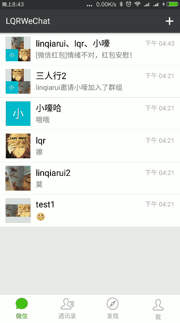
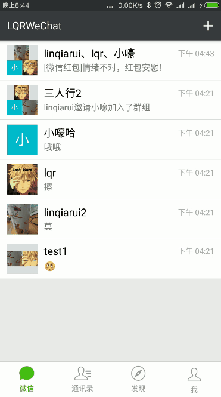
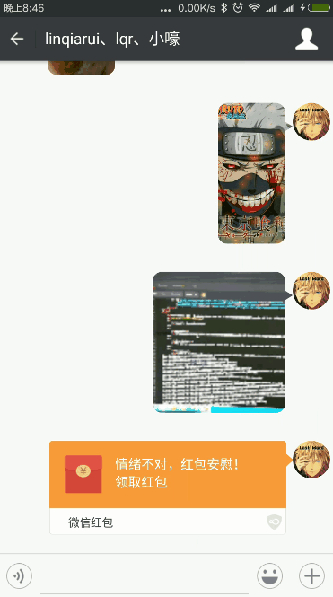
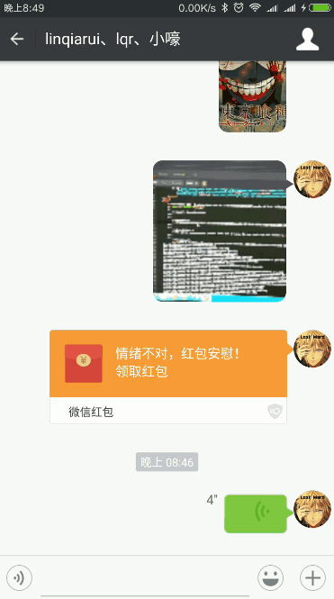
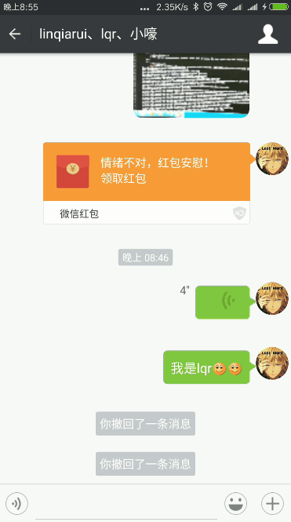
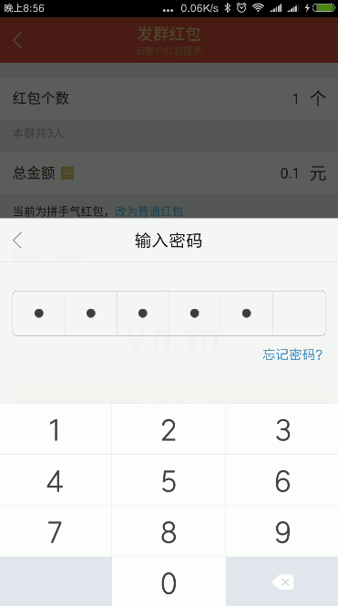
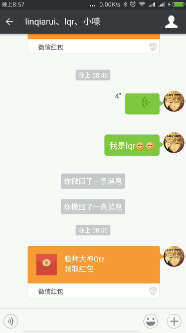
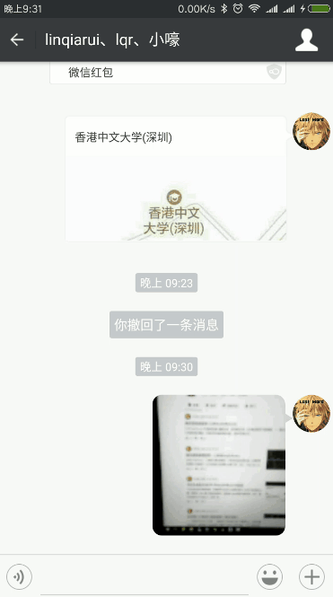
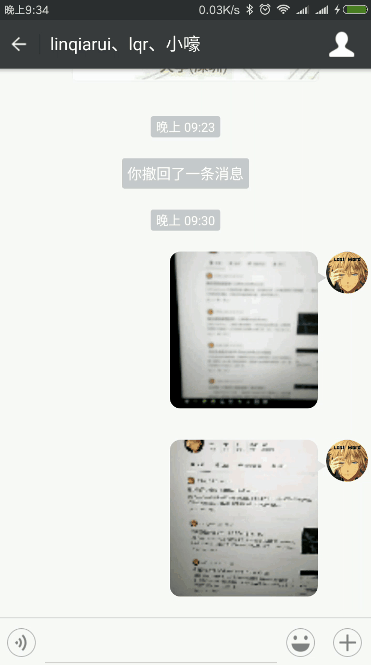
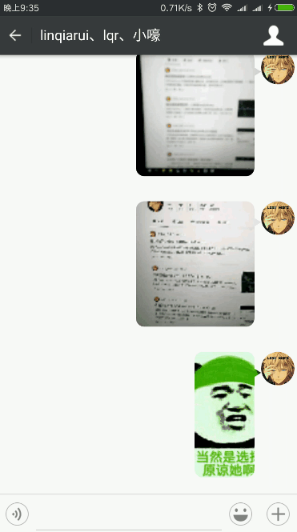
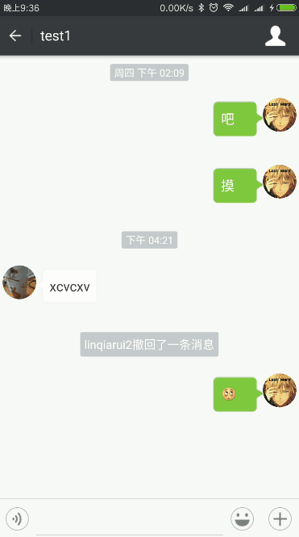
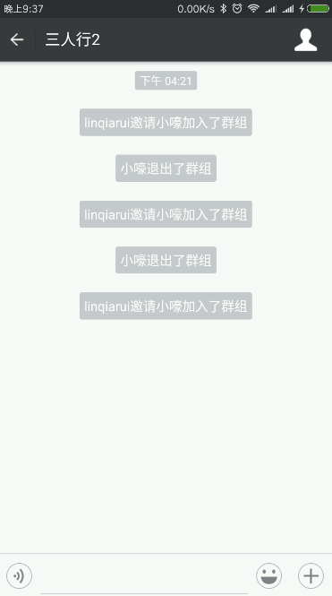
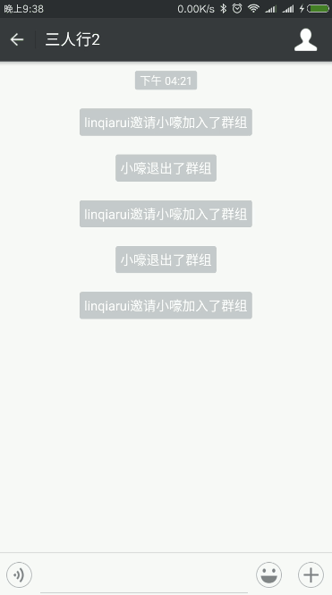
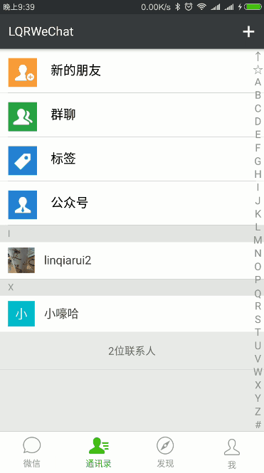


# 4. More

## 1. Technologies Used

1. RxJava 1.x
1. Retrofit 2.0
1. MVP 
1. Glide
1. lambda
1. ...

## 2. Main Libraries Used

### Libraries by other great developers

1. [AutoLayout by hongyangAndroid](https://github.com/hongyangAndroid/AndroidAutoLayout)
1. [LitePal by Guo Lin](https://github.com/LitePalFramework/LitePal)
1. [Universal pull-to-refresh view by bingoogolapple](https://github.com/bingoogolapple/BGARefreshLayout-Android)
1. [QR code scanning library by bingoogolapple](https://github.com/bingoogolapple/BGAQRCode-Android)
1. [WeChat-style camera view for Android by CJT2325](https://github.com/CJT2325/CameraView)
1. ...

### Libraries I (GitLqr) made

1. [Universal adapter](https://github.com/GitLqr/LQRAdapterLibrary)
1. [Wrapped RecyclerView](https://github.com/GitLqr/LQRRecyclerViewLibrary)
1. [WeChat-style emoji library](https://github.com/GitLqr/LQREmojiLibrary)
1. [WeChat-style audio library](https://github.com/GitLqr/LQRAudioRecord)
1. [WeChat-style image picker](https://github.com/GitLqr/LQRImagePicker)
1. [WeChat-style nine-grid image view](https://github.com/GitLqr/LQRNineGridImageView)
1. [Common option item view](https://github.com/GitLqr/LQROptionItemView)

## 3. Notes and Acknowledgements

No test account is provided. Please register with your own phone number and log in. I only have a limited number of phone numbers, so my testing was quite limited and there may be bugs I am not aware of. Please bear with me, and feel free to open an issue. I made this project purely to improve my own Android skills, so it relies on the server provided by RongCloud as its backend. That server is written in Node.js, and at the moment I can only write backends in Java, so adding other server-side features is not possible for now. If you are interested, take a look at the [SealTalk IM app server](https://github.com/rongcloud/sealtalk-server). Of course RongCloud has its own pitfalls too, especially the red packet module, which I simply stopped using. I hope this project helps those who are running into the same pitfalls (at least I have been through them once, hehe). Finally, many thanks to everyone who has supported me, including those who sent me private messages of encouragement on CSDN. I am truly touched. Thank you.

## 4. Build Instructions

The current toolchain is AGP 2.3 + Gradle 3.3, which requires JDK 8 to build. Some dependencies (AutoLayout, LitePal 1.5, etc.) went offline together with jcenter, so the project cannot be built directly at the moment; migration is in progress.

The lqr libraries live under `libraries/` as git submodules, so clone with submodules:

```
git clone --recursive https://github.com/GitLqr/LQRWeChat.git
# If you have already cloned it
git submodule update --init
```

Before running, replace the following with your own configuration:

1. RongCloud AppKey: `RONG_CLOUD_APP_KEY` in `AndroidManifest.xml`
1. Tencent Maps key: `TencentMapSDK` in `AndroidManifest.xml`
1. ShareSDK platform keys: `app/src/main/assets/ShareSDK.xml`
1. Server address: `BASE_URL` in `MyApi.java`. The original `api.sealtalk.im` is no longer available, so you need to deploy [sealtalk-server](https://github.com/rongcloud/sealtalk-server) yourself
1. Red packet signing service: `initRedPacket()` in `MyApp.java`

# 5. Support the Author

Finally, if you find this project useful, feel free to send a tip to encourage me to keep creating. Thanks!


[](https://dartnode.com "Powered by DartNode - Free VPS for Open Source")
